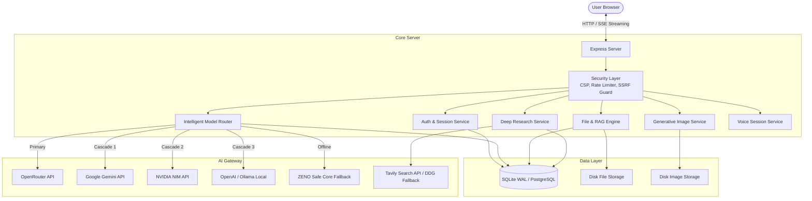
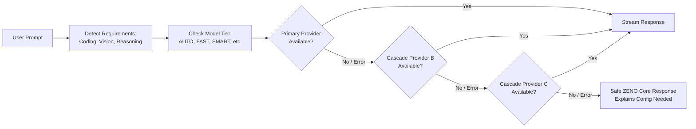
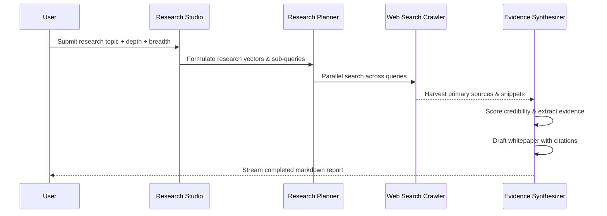

# ZENO AI NEXT — Architecture Specification

## 1. System Architecture Overview

ZENO AI NEXT is designed around a decoupled, modular full-stack architecture prioritizing low latency, resilient failover, and high security.

---

## 2. Intelligent Routing & Failover Pipeline

The Intelligent Router inspects user intent, capability requirements (such as code synthesis, mathematical reasoning, vision, or multi-step tools), and evaluates candidate availability:

---

## 3. Deep Research Multi-Agent Pipeline

---

## 4. Database Schema Design

The relational database is architected for strict referential integrity and performance:

1. **`users` & `user_profiles`**: Authentication credentials (salted PBKDF2), role-based permissions (`admin`, `user`), and user styling configuration.
2. **`sessions`**: SHA-256 hashed session tokens with sliding TTL expiration.
3. **`conversations` & `messages`**: Multi-turn conversation sessions with model attribution, mode markers, attachments, and feedback.
4. **`message_citations`**: Structured sources with URL, snippet, and credibility index.
5. **`projects`**: Isolated workspaces providing distinct system instructions, theme colors, and attached file boundaries.
6. **`files` & `file_chunks`**: Document metadata, extracted raw text, and 600-character chunk embeddings for contextual retrieval.
7. **`research_jobs` & `research_sources`**: Deep research dossiers, multi-step execution plans, and bibliographies.
8. **`memories`**: Long-term user directives and preferences categorized into preferences, facts, and technical habits.
9. **`audit_logs` & `usage_records`**: Security monitoring and resource consumption tracking.
